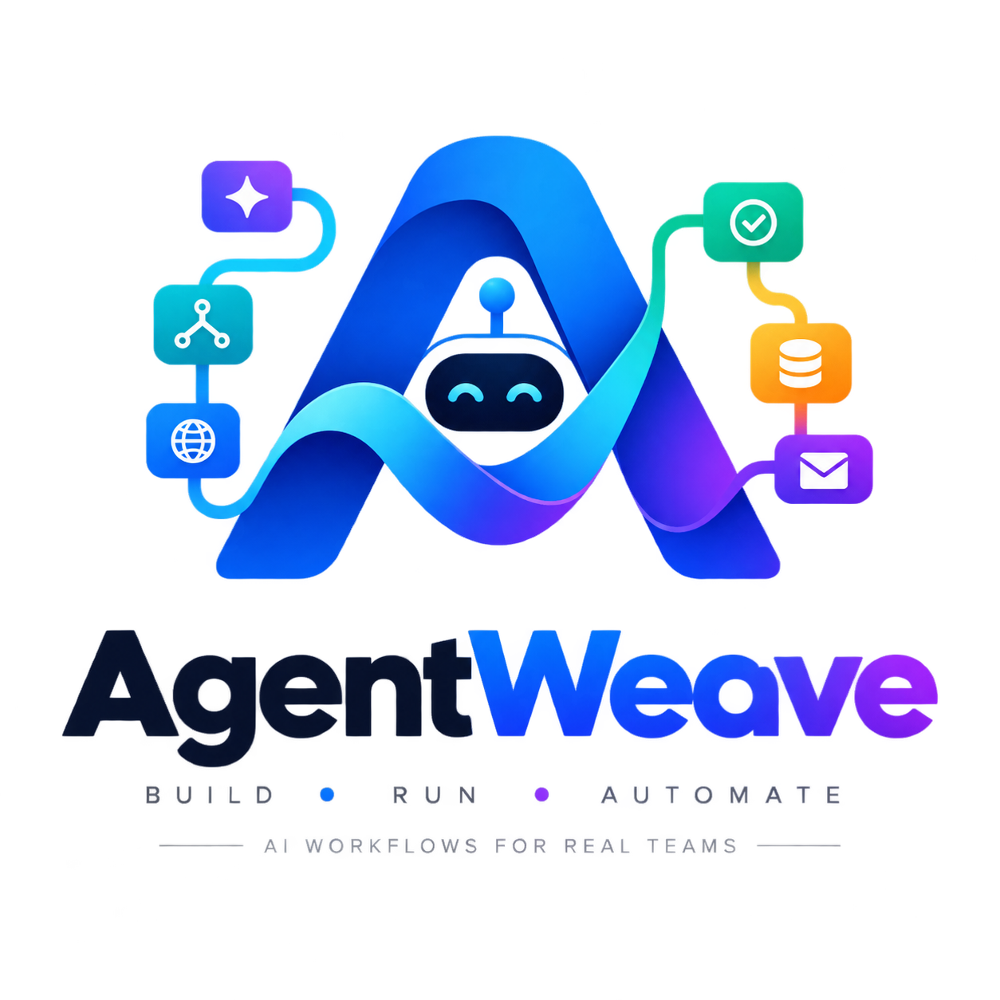
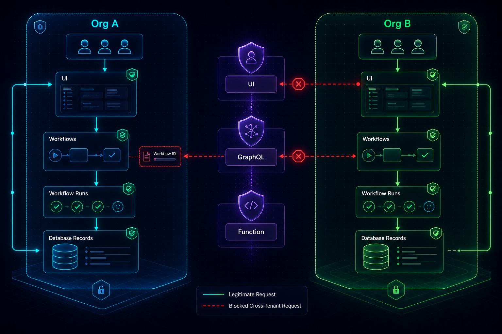

# AgentWeave — Secure Multi-Tenant AI Workflow Orchestration Platform

<p align="center">
  
</p>

<p align="center">
  
</p>

AgentWeave is a working multi-tenant workflow application built with Next.js, Nhost Auth, Hasura GraphQL, PostgreSQL, Nhost Functions, Gemini, and Resend. It demonstrates organization-scoped authorization, live execution updates, protected approval/resume, quota enforcement, and four ways to start the same workflow runner.

## Demonstrated scenario

```text
Customer message
  -> Gemini structured classification
  -> conditional urgent/non-urgent branch
  -> HTTPS request on the urgent path
  -> approval gate pauses the run
  -> owner/editor approval resumes it
  -> PostgreSQL output is saved
  -> notification outbox row is inserted
  -> Hasura Event Trigger invokes Resend
  -> run completes and quota increments
```

The workflow detail page streams `step_runs` over GraphQL subscriptions, so running, skipped, awaiting-approval, failed, and completed states appear without a refresh.

<p align="center">
  
</p>

## Product walkthrough

> [!NOTE]
> These slots are intentionally reserved for real screenshots from the hosted application. Replace each placeholder after the final Vercel and Nhost Cloud smoke test; generated artwork should not be presented as evidence that the product works.

| Workflow dashboard | Vertical workflow builder |
| --- | --- |
| 📷 **Production screenshot placeholder**<br><sub>Add the organization switcher, role badge, quota, and workflow list.</sub> | 📷 **Production screenshot placeholder**<br><sub>Add the configured Customer Escalation Workflow.</sub> |

| Paused approval gate | Completed run and email |
| --- | --- |
| 📷 **Production screenshot placeholder**<br><sub>Add the live timeline paused at `awaiting_approval`.</sub> | 📷 **Production screenshot placeholder**<br><sub>Add the completed timeline and Resend delivery proof.</sub> |

## Stack

- Next.js 16, React 19, TypeScript, Tailwind CSS
- Nhost Auth and Node.js 22 Functions
- PostgreSQL 14 and Hasura GraphQL
- Apollo Client and `graphql-ws`
- Gemini structured output
- Resend email delivery through a Hasura Event Trigger
- Vercel frontend and Nhost Cloud backend

## Architecture

<p align="center">
  
</p>

The browser authenticates with Nhost and uses Hasura queries, mutations, Actions, and subscriptions. Manual, webhook, scheduled, and database-event entry points converge on the same Nhost Function workflow runner.

## Repository map

```text
app/                         Next.js routes
components/                  auth provider, shell, workflow editor
functions/                   Nhost handlers and shared workflow runner
nhost/migrations/default/    PostgreSQL schema and rollback
nhost/metadata/              Hasura tables, permissions, Actions and triggers
scripts/                     local secret, seed and attack-test utilities
ARCHITECTURE.md              tenancy and execution design
DEMO.md                      recording and reviewer walkthrough
```

## Local setup

Prerequisites: Node.js 20+, Docker, and the [Nhost CLI](https://docs.nhost.io/platform/cli/local-development).

1. Install dependencies and create local Nhost secrets.

   ```bash
   npm install
   ./scripts/generate-local-secrets.sh
   ```

2. Start Nhost from this directory.

   ```bash
   nhost up
   ```

   Migrations and metadata are applied by the CLI. Confirm the metadata status in the local Hasura console before continuing.

3. Copy the environment template.

   ```bash
   cp .env.example .env.local
   ```

   Replace the local admin secret with the value in the ignored `.secrets` file. The included demo password is intentionally public for reviewer access; use the same value for `DEMO_PASSWORD` and `NEXT_PUBLIC_DEMO_PASSWORD` when seeding. Replace or remove it outside this demonstration.

4. Seed two organizations and five role-specific users.

   ```bash
   set -a
   source .env.local
   set +a
   npm run demo:seed
   ```

   The seed is idempotent. It creates:

   | Account | Organization | Role |
   | --- | --- | --- |
   | `owner@orga.agentweave.demo` | Northstar Support | owner |
   | `editor@orga.agentweave.demo` | Northstar Support | editor |
   | `viewer@orga.agentweave.demo` | Northstar Support | viewer |
   | `owner@orgb.agentweave.demo` | Helix Operations | owner |
   | `editor@orgb.agentweave.demo` | Helix Operations | editor |

   The login page shows these accounts and the shared password for easy reviewer access. This is a deliberate demo-only exception and is prominently labeled for removal in a real deployment.

5. Start the frontend.

   ```bash
   npm run dev
   ```

   Open [http://localhost:3000](http://localhost:3000).

### Local HTTP mode

`nhost up --disable-tls` is also supported. In that mode, set the script URLs to `http://local.auth.local.nhost.run:443/v1` and `http://local.graphql.local.nhost.run:443/v1`. The browser client normally uses the standard TLS-enabled local Nhost URLs.

## Secrets and environment variables

Browser variables:

```text
NEXT_PUBLIC_NHOST_SUBDOMAIN
NEXT_PUBLIC_NHOST_REGION
```

Nhost Cloud Function secrets:

```text
GEMINI_API_KEY
RESEND_API_KEY
RESEND_FROM_EMAIL
DEMO_NOTIFICATION_EMAIL
```

Nhost supplies `NHOST_GRAPHQL_URL`, `NHOST_ADMIN_SECRET`, and `NHOST_WEBHOOK_SECRET` to Functions. Gemini, Hasura admin, Resend, and webhook secrets are never sent to the browser.

## Security model

All users authenticate under the normal Hasura `user` role. Organization authority is derived from `org_members`, where each membership is `owner`, `editor`, or `viewer`.

- Hasura row permissions scope every query and mutation through organization membership.
- Owners may configure every step and trigger and manage memberships.
- Editors may run, approve, and edit safe workflow configuration.
- Viewers are read-only.
- `db_write`, `notify`, and webhook configuration are owner-only.
- The frontend hides unavailable controls, Hasura blocks direct mutations, and `saveWorkflow` independently validates the full submitted graph.
- All Nhost handlers validate Hasura's webhook secret; user Actions additionally validate the forwarded JWT claims.
- HTTP steps allow only HTTPS GET/POST/PUT/PATCH, reject loopback destinations, cap execution at 10 seconds, reject redirects, and limit responses to 256 KiB.

For the full request and data flow, see [ARCHITECTURE.md](./ARCHITECTURE.md).

<p align="center">
  
</p>

## GraphQL API

Hasura Actions expose:

- `saveWorkflow(input)` — validates and atomically saves the workflow, steps, and triggers.
- `triggerWorkflowRun(workflowId, input)` — owner/editor manual execution.
- `triggerWorkflowWebhook(workflowId, secret, input)` — public endpoint with a hashed workflow secret.
- `approveStep(stepRunId)` — one-time owner/editor approval and protected resume.

Manual Actions, webhook Actions, cron events, and database events all call the same `startWorkflow({ workflowId, triggerType, input, actor })` implementation.

## Verification

Run static checks:

```bash
npm run lint
npm run typecheck
npm run build
```

With Nhost running and the seed environment loaded, run the tenant attack suite:

```bash
npm run security:test
```

The checked scenario verifies that Org B receives `null` when querying an Org A workflow ID and `FORBIDDEN` when attempting to run or approve Org A data. The local integration pass also covers viewer denial, editor restricted-step denial, successful approval/resume, duplicate-approval rejection, quota increment, webhook-secret rejection, database-event execution, and scheduled execution.

## Deployment

1. Create an Nhost Cloud project and connect this repository so migrations, metadata, and root `functions/` deploy together.
2. Add the four Function secrets listed above. Use a verified Resend sender/domain.
3. Run the bootstrap script against the Cloud Auth and GraphQL URLs using the Cloud admin secret and the shared demo password.
4. Import the repository into Vercel and set `NEXT_PUBLIC_NHOST_SUBDOMAIN`, `NEXT_PUBLIC_NHOST_REGION`, and the matching `NEXT_PUBLIC_DEMO_PASSWORD`.
5. Add the Vercel origin to the Nhost Auth client URL and allowed redirect URLs, then repeat the security checks and the walkthrough in [DEMO.md](./DEMO.md) against production.

No API keys, Hasura admin secrets, webhook secrets, Gemini keys, or Resend keys are committed. The shared demo login is intentionally public and must be removed or replaced before adapting this project for real users.
